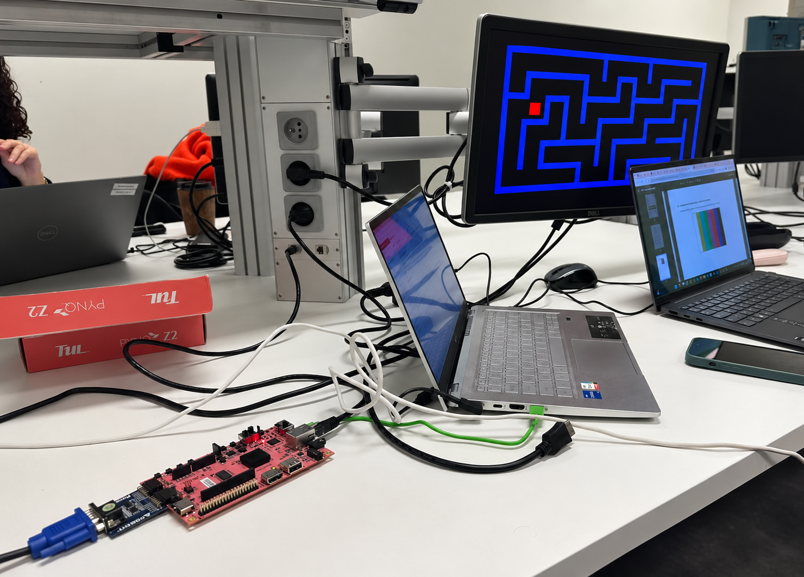

# VGA maze project — DDC

A Verilog project for the **PYNQ-Z2 FPGA board**, developed for Digital Design Concepts at KU Leuven.

Four board buttons move a red square horizontally, vertically or diagonally across a 640 × 480 VGA display. A blue maze provides the visual setting, and position limits keep the square on screen. Board LEDs provide feedback for directional inputs.

## Report and demonstration

- **[Project report](docs/maze-project-report.pdf)** — design overview, movement FSM, controls and implementation results.
- **[Maze photograph](images/maze-display.png)** — the display output and laboratory setup.
- **[LED-feedback video](media/pynq-led-blink.mp4)** — a short demonstration of the board's LED feedback during button input.

## Controls

| Input | Action |
|---|---|
| BTN0 / BTN1 | Up / down |
| BTN2 / BTN3 | Left / right |
| One vertical and one horizontal button | Diagonal movement |
| SW0 | Reset the position and FSM |

## Project files

The code is committed as an unpacked Vivado project and can be browsed directly.

- **[src/](src/)** — Vivado project file, Verilog modules, testbenches, constraints, block designs and IP files.
- **[docs/](docs/)** — the project report and archived timing report.
- **[images/](images/)** — the maze photograph.
- **[media/](media/)** — the LED-feedback recording.
- **[hardware/](hardware/)** — the archived FPGA programming file.

## Open the project

1. Clone or download this repository.
2. Open **[src/final_project.xpr](src/final_project.xpr)** in Vivado.
3. Use the PYNQ-Z2 board and the VGA connection shown in the photograph.

The original toolchain was **Vivado 2020.1**, targeting **xc7z020clg400-1**. A different Vivado release may request IP updates or regeneration. The archived implementation completed bitstream generation on 18 December 2024 and met its user-specified timing constraints.

## Authors

**Ibrahim Ibrahimov and Ali Shirinov**

Part of the [embedded-hardware collection](https://github.com/ibrahim2806/embedded-hardware).
